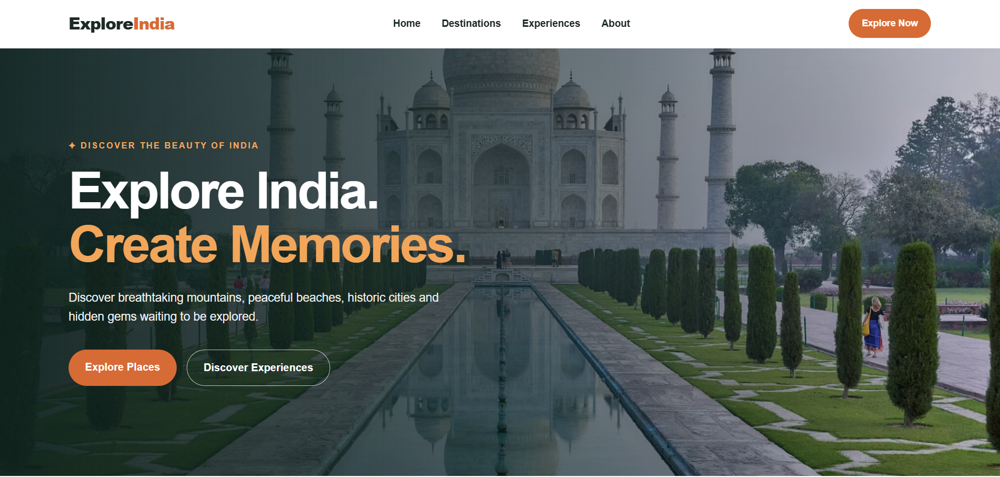
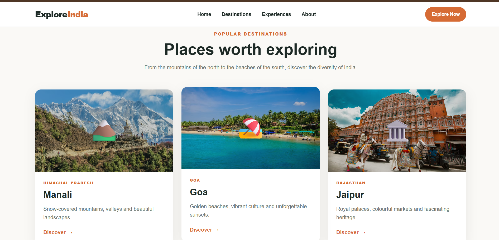
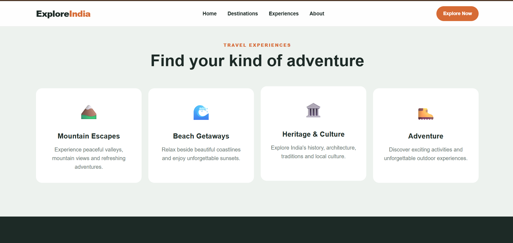
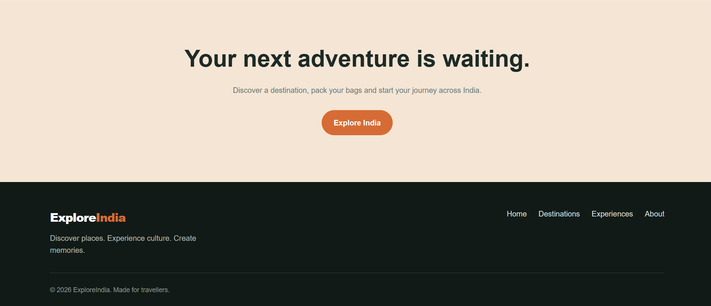

# 🇮🇳 Explore India – Travel Landing Page

### Oasis Infobyte Internship | Web Development & Designing
**Task 1: Landing Page**

Explore India is a responsive travel landing page designed to showcase beautiful destinations, memorable experiences, and the cultural diversity of India.

This project was developed as part of my Oasis Infobyte Web Development and Designing internship to practise HTML, CSS, and responsive web design.

---

## 📌 Project Overview

India offers a wide variety of travel experiences, from peaceful mountain destinations to beautiful beaches and historical landmarks.

The Explore India landing page introduces visitors to some of these destinations through an attractive layout, destination cards, and travel-focused content.

The website aims to provide a clean, user-friendly browsing experience across desktop and mobile devices.

---

## ✨ Features

- Sticky navigation bar
- Attractive hero section
- Call-to-action buttons
- Popular destination cards
- Travel experiences section
- About section
- Final call-to-action section
- Footer with navigation links
- Consistent colour palette
- Responsive layout
- CSS Flexbox and Grid
- Smooth scrolling
- Hover effects on interactive elements
- Mobile-friendly design

---

## 🛠️ Technologies Used

| Technology | Purpose |
|---|---|
| HTML5 | Website structure and content |
| CSS3 | Styling, colours, spacing, and layout |
| CSS Flexbox | Flexible alignment of elements |
| CSS Grid | Organising cards and content |
| CSS Media Queries | Responsive layouts for different screen sizes |

---

## 🌍 Destinations Featured

### 1. Manali
A popular mountain destination known for its scenic valleys, snowy landscapes, and outdoor adventures.

### 2. Goa
A coastal destination known for its beaches, sunsets, and relaxing atmosphere.

### 3. Jaipur
A historic city known for its royal palaces, colourful streets, and cultural heritage.

---

## 📸 Screenshots

Screenshots of the website are stored in the `screenshots` folder.

### 1. Home Section



### 2. Popular Destinations



### 3. Experiences and About Section



### 4. Call to Action and Footer



---

## 📁 Project Structure

```text
WebDev-L1-LandingPage/
│
├── index.html
├── style.css
├── README.md
│
└── screenshots/
    ├── 01-home.png
    ├── 02-destinations.png
    ├── 03-experiences.png
    └── 04-footer.png
```

---

## 🚀 How to Run the Project

1. Download or clone the repository.
2. Open the `WebDev-L1-LandingPage` folder.
3. Open `index.html` in a web browser.
4. Scroll through the page to explore the different sections.

No additional installation is required.

An internet connection may be required to load the externally hosted destination images.

---

## 📱 Responsive Design

The website uses CSS media queries, Flexbox, and Grid to adapt its layout to different screen sizes.

It is designed to be usable on:

- Desktop computers
- Laptops
- Tablets
- Mobile phones

---

## 🎯 Learning Outcomes

Through this project, I practised:

- Structuring web pages with semantic HTML
- Styling elements with CSS
- Creating navigation menus
- Designing hero sections and destination cards
- Using Flexbox and Grid
- Implementing responsive layouts
- Adding hover effects and smooth scrolling
- Organising project files for GitHub

---

## 👩‍💻 Author

**Puchakayala Yaswanthi**

B.Tech – Computer Science Engineering

**Internship:** Web Development & Designing  
**Organisation:** Oasis Infobyte

---

## 📄 Acknowledgement

I would like to thank Oasis Infobyte for providing the opportunity to practise web development skills through this internship project.

---

*Built with HTML5 and CSS3.*