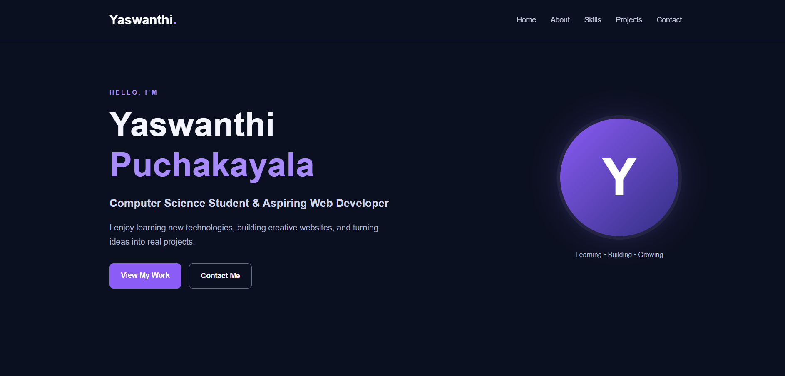
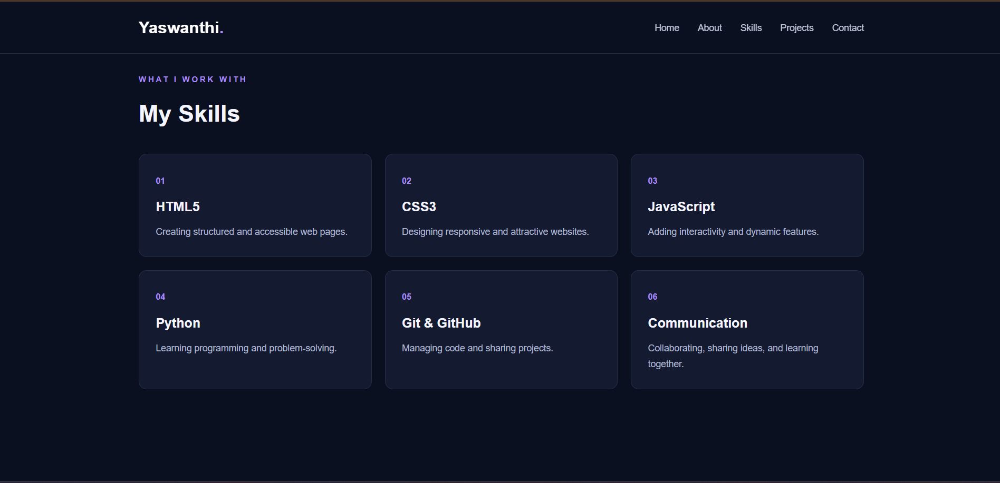
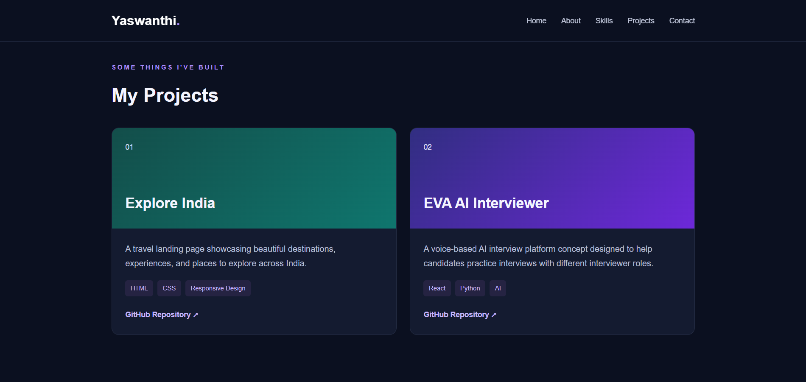
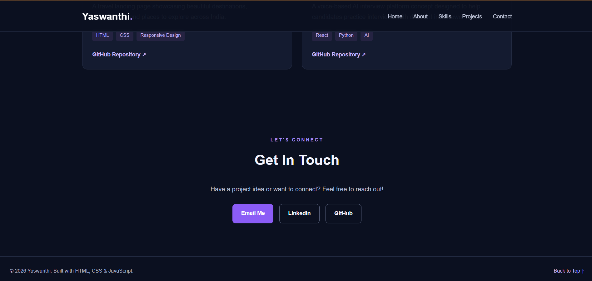

# 💻 Personal Portfolio Website

### Oasis Infobyte Internship | Web Development & Designing
**Task 2: Personal Portfolio**

## 📌 Project Overview

This project is a responsive personal portfolio website developed as part of my Oasis Infobyte Web Development and Designing internship.

The website introduces me, highlights my technical skills, showcases my projects, and provides ways to contact me.

My goal is to build a professional online presence while improving my web development and design skills.

---

## ✨ Features

- Personal introduction and hero section
- About Me section
- Technical skills displayed using cards
- Project showcase with descriptions
- Contact section
- Email, LinkedIn, and GitHub links
- Sticky navigation bar
- Smooth scrolling
- Responsive mobile navigation menu
- Hover effects and interactive elements
- Responsive layout for desktop and mobile devices
- Consistent colours and typography

---

## 🛠️ Technologies Used

| Technology | Purpose |
|---|---|
| HTML5 | Website structure and content |
| CSS3 | Styling, layouts, colours, and animations |
| JavaScript | Mobile navigation interactions |
| CSS Flexbox | Flexible layout and alignment |
| CSS Grid | Skills and project card layouts |
| Media Queries | Responsive design |

---

## 👩‍💻 About Me

I'm a Computer Science Engineering student interested in technology, web development, and continuous learning.

I enjoy exploring new ideas, developing practical projects, and improving my technical and communication skills.

My goal is to gain practical experience and become a skilled developer.

---

## 🧰 Skills

The portfolio currently highlights the following skills:

- HTML5
- CSS3
- JavaScript
- Python
- Git and GitHub
- Communication

---

## 🚀 Projects

### 1. Explore India — Travel Landing Page

A responsive travel landing page showcasing beautiful destinations and travel experiences across India.

**Technologies:** HTML5, CSS3

**Repository:** Add your actual project URL here.

### 2. EVA AI Interviewer

A voice-based AI interview platform concept designed to help candidates practise interviews with different interviewer roles.

**Technologies:** React, Python, AI

**Repository:** Add your actual project URL here.

---

## 📸 Screenshots

Screenshots of the portfolio are stored in the `screenshots` folder.

### 1. Home Section



### 2. About Me and Skills



### 3. Projects



### 4. Contact and Footer



---

## 📁 Project Structure

```text
WebDev-L1-Portfolio/
│
├── index.html
├── style.css
├── script.js
├── README.md
│
└── screenshots/
    ├── 01-home.png
    ├── 02-about-skills.png
    ├── 03-projects.png
    └── 04-contact-footer.png
```

---

## ▶️ How to Run the Project

1. Download or clone the repository.
2. Open the `WebDev-L1-Portfolio` folder.
3. Open `index.html` in a web browser.
4. Navigate through the different sections.
5. Test the navigation menu on a mobile-sized screen.

No additional installation is required.

---

## 📱 Responsive Design

The portfolio uses CSS media queries, Flexbox, and Grid to adapt to different screen sizes.

It is designed to be usable on:

- Desktop computers
- Laptops
- Tablets
- Mobile phones

JavaScript controls the mobile navigation menu.

---

## 🎯 Learning Outcomes

Through this project, I practised:

- Structuring web pages using HTML
- Styling responsive layouts with CSS
- Creating navigation menus
- Organising skills and project cards
- Using JavaScript event listeners
- Implementing responsive navigation
- Creating a personal portfolio
- Organising project files for GitHub

---

## 👩‍🎓 Author

**Puchakayala Yaswanthi**

B.Tech — Computer Science Engineering

**Internship:** Web Development & Designing  
**Organisation:** Oasis Infobyte

---

## 📄 Acknowledgement

I would like to thank Oasis Infobyte for providing an opportunity to practise web development skills through this internship project.

---

*Built with HTML, CSS, and JavaScript.*