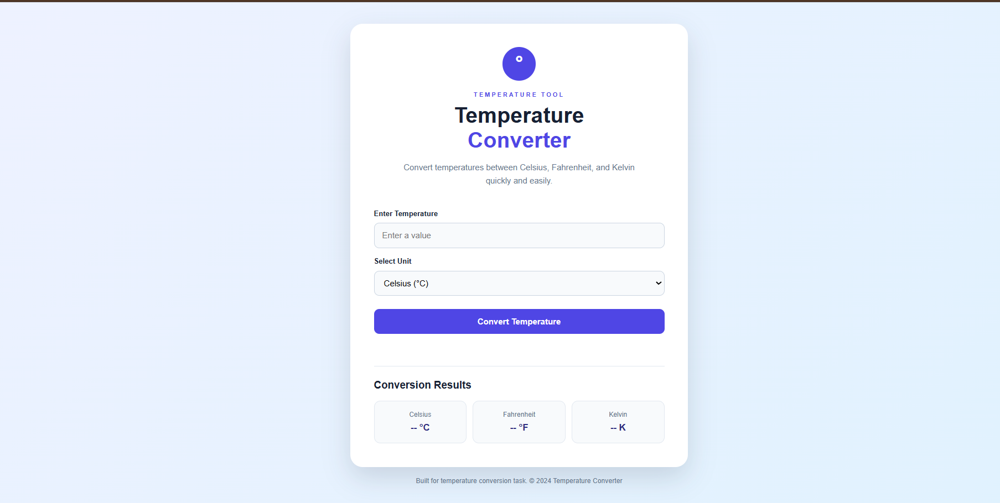
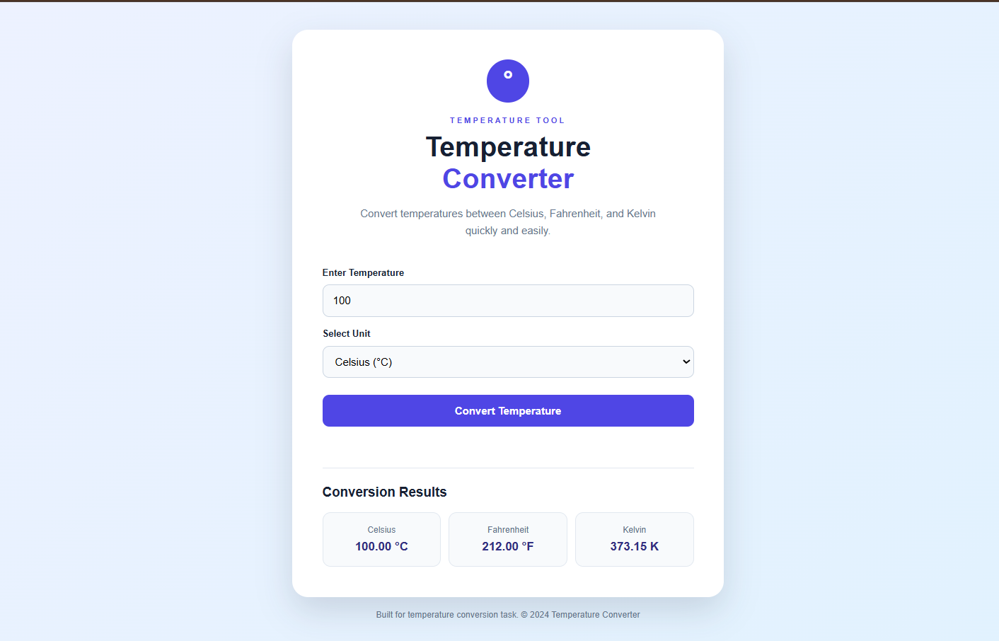
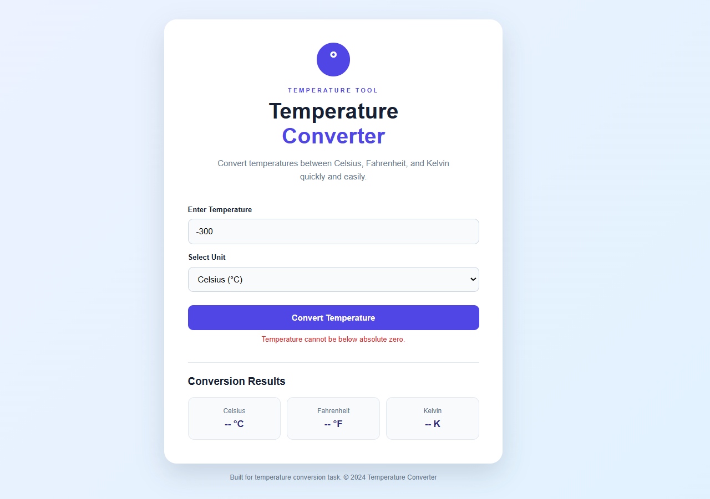

# 🌡️ Temperature Converter Website

### Oasis Infobyte Internship | Web Development & Designing
**Task 3: Temperature Converter**

## 📌 Project Overview

The Temperature Converter is an interactive web application developed as part of my Oasis Infobyte Web Development and Designing internship.

It allows users to convert temperatures between Celsius, Fahrenheit, and Kelvin using a simple and responsive interface.

The project demonstrates my understanding of HTML, CSS, JavaScript, mathematical calculations, and input validation.

---

## ✨ Features

- Convert temperatures between Celsius, Fahrenheit, and Kelvin.
- Enter a temperature using a numeric input field.
- Select the input temperature unit.
- Display all three temperature values simultaneously.
- Validate empty and invalid input.
- Display error messages for temperatures below absolute zero.
- Show conversion results with appropriate unit labels.
- Responsive design for mobile and desktop devices.
- Clean and user-friendly interface.
- Interactive conversion button.

---

## 🛠️ Technologies Used

| Technology | Purpose |
|---|---|
| HTML5 | Structures the application |
| CSS3 | Styles the interface |
| JavaScript | Performs temperature calculations |
| CSS Flexbox | Aligns and arranges interface elements |
| CSS Grid | Organises conversion result cards |
| CSS Media Queries | Adapts the layout to different screen sizes |

---

## 🌡️ Supported Temperature Units

The application supports three temperature scales:

- **Celsius (°C)**
- **Fahrenheit (°F)**
- **Kelvin (K)**

Users can select any supported unit as the input and view the corresponding values in all three scales.

---

## 🔢 Temperature Conversion Formulas

### Celsius to Fahrenheit

```text
°F = (°C × 9/5) + 32
```

### Fahrenheit to Celsius

```text
°C = (°F - 32) × 5/9
```

### Celsius to Kelvin

```text
K = °C + 273.15
```

### Kelvin to Celsius

```text
°C = K - 273.15
```

### Fahrenheit to Kelvin

```text
K = (°F + 459.67) × 5/9
```

### Kelvin to Fahrenheit

```text
°F = (K × 9/5) - 459.67
```

---

## ✅ Input Validation

The application includes validation to handle incorrect temperature values.

Examples:

- Empty input displays an error message.
- Invalid numeric input is rejected.
- Celsius temperatures below -273.15 °C are rejected.
- Fahrenheit temperatures below -459.67 °F are rejected.
- Kelvin temperatures below 0 K are rejected.

These checks prevent physically impossible temperatures below absolute zero from being converted.

---

## 📸 Screenshots

Screenshots demonstrating the application's interface and functionality are stored in the `screenshots` folder.

### 1. Temperature Converter Interface



### 2. Temperature Conversion Results



### 3. Input Validation



---

## 📁 Project Structure

```text
WebDev-L1-TemperatureConverter/
│
├── index.html
├── style.css
├── script.js
├── README.md
│
└── screenshots/
    ├── 01-home.png
    ├── 02-conversion.png
    └── 03-validation.png
```

---

## 🚀 How to Run the Project

1. Download or clone the repository.
2. Open the `WebDev-L1-TemperatureConverter` folder.
3. Open `index.html` in a web browser.
4. Enter a temperature value.
5. Select Celsius, Fahrenheit, or Kelvin.
6. Click the **Convert Temperature** button.
7. View the converted values.

No additional installation is required.

---

## 📱 Responsive Design

The application uses CSS media queries to adapt its layout to different screen sizes.

It is designed to work on:

- Desktop computers
- Laptops
- Tablets
- Mobile phones

---

## 🎯 Learning Outcomes

Through this project, I practised:

- Creating web interfaces using HTML5.
- Styling web applications using CSS3.
- Handling user interactions with JavaScript.
- Working with mathematical conversion formulas.
- Validating user input.
- Displaying dynamic results using DOM manipulation.
- Handling errors with user-friendly messages.
- Creating responsive web layouts.
- Organising a project for GitHub.

---

## 👩‍💻 Author

**Puchakayala Yaswanthi**

B.Tech – Computer Science Engineering

**Internship:** Web Development & Designing  
**Organisation:** Oasis Infobyte

---

## 📄 Acknowledgement

I would like to thank Oasis Infobyte for providing the opportunity to improve my web development skills through this internship project.

---

*Built with HTML5, CSS3, and JavaScript.*